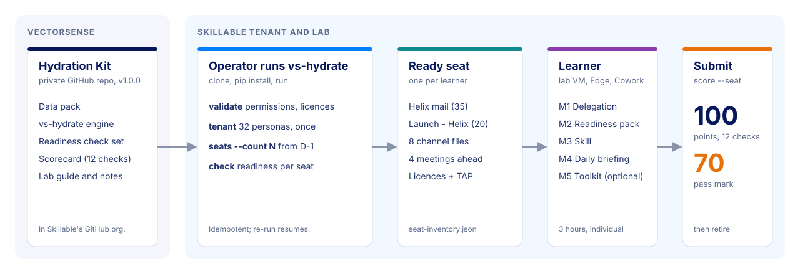

# Launch Command Center: Delegate, Verify and Automate with Microsoft 365 Copilot Cowork

**Track:** COWORK-T1 · Advanced · 3 hours · Individual

Zava Corporation's Helix product ships in 10 days, its launch lead has moved on, and the job is now yours. A supplier problem is still open, an executive wants to know whether the date holds, two decisions are stuck in Microsoft Teams, the spec and the launch plan disagree, and your calendar is double-booked. Microsoft 365 Copilot Cowork does the legwork while you keep the final say.

This repository holds the lab instructions and the **Hydration Kit** that builds the lab's Microsoft 365 workplace: it fills a tenant with the Helix launch, prepares one ready seat per learner, checks every seat before release, and scores the learner when they select Submit.



## Lab outline

| Milestone | Time | What the learner does |
|---|---|---|
| M1 Master the delegation controls | 40 min | Sourced catch-up, three reply drafts, stop and resume, Always allow granted and revoked |
| M2 Build the readiness pack from a single brief | 52 min | Deck, 10-column risk register, one-page customer PDF and status card; traced to source and corrected |
| M3 Capture your reporting standard as a skill | 35 min | Launch Status Report skill, proven in a new task |
| M4 Schedule the daily launch briefing | 23 min | Weekday 8am briefing; first send approved |
| M5 Combine skills into a toolkit (optional) | 44 min | Second skill with a template, both skills in one task, shared, inventoried |

Scoring: 12 automatic checks, 100 points, pass mark 70. Learner instructions are in [instructions/](instructions/).

## Repository layout

| Folder | Contents |
|---|---|
| [`.github/`](.github/) | CI: validates the data sources, runs the tests, rehearses the operator flow offline |
| [`data/`](data/) | The Helix story as data (`helix/`), the built data pack (`release/`), the readiness check set and the scorecard |
| [`docs/`](docs/) | Operator guide for the lab host, engine and data pack references, release notes |
| [`img/`](img/) | Diagrams |
| [`infra/`](infra/) | Configuration template and Entra app registration setup |
| [`instructions/`](instructions/) | Learner lab guide (plain and Skillable markdown) and instructor notes |
| [`src/`](src/) | `vs-hydrate` engine, its tests, and the data pack builder |

## Quick start

Requires Python 3.11 or later and git. Run from the repository root:

```bash
python -m venv .venv && source .venv/bin/activate     # Windows: .venv\Scripts\activate
pip install ./src/engine
vs-hydrate --version
```

Rehearse the whole operator flow against an in-memory tenant, no Microsoft 365 needed:

```bash
cp infra/config/tenant.example.yaml tenant.yaml
vs-hydrate validate --offline
vs-hydrate tenant --offline
vs-hydrate seats --count 3 --offline
vs-hydrate check --offline
vs-hydrate score --seat lab0001@zava.example --offline
```

Running against a real tenant: [docs/operator-guide.md](docs/operator-guide.md).

### Development

```bash
pip install -e "./src/engine[test]" python-docx openpyxl reportlab pillow
python src/tools/build_datapack.py      # rebuild data/release/helix-datapack-1.0.0.zip after editing data/helix/
python -m pytest src/engine/tests -q    # offline tests
```

## Status

| Component | State |
|---|---|
| Data pack, readiness check set, scorecard | Complete for 1.0.0 |
| Engine against the in-memory tenant | Complete; 23 tests pass |
| Engine against a real Microsoft 365 tenant | Not yet run; first pilot needs a test tenant |
| Delivery | Private GitHub repository in Skillable's organisation; releases are git tags (`v1.0.0`) |

## Notes

Zava Corporation is Microsoft's fictional company. Every person, company and product in the lab data is fictional. See [LICENSE](LICENSE) for code and [LICENSE-DOCS](LICENSE-DOCS) for documentation.
